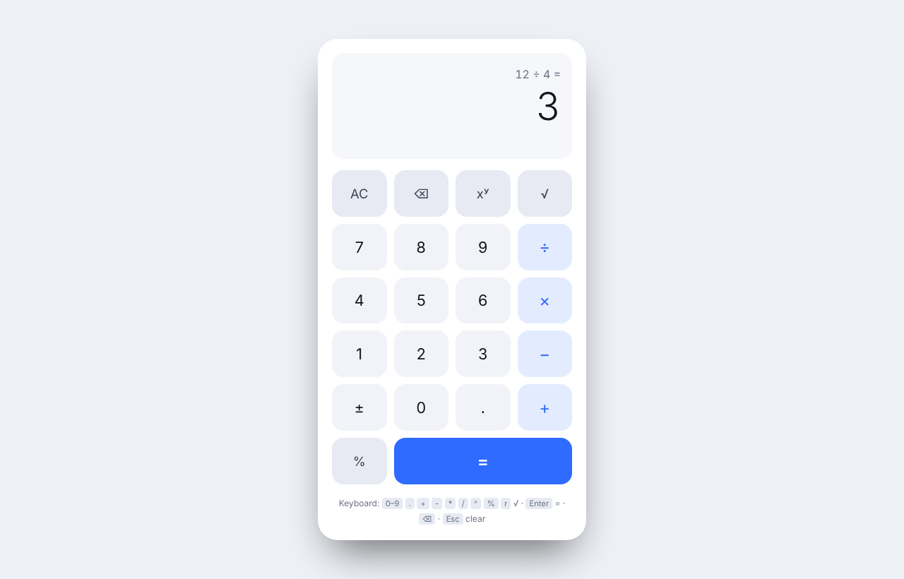
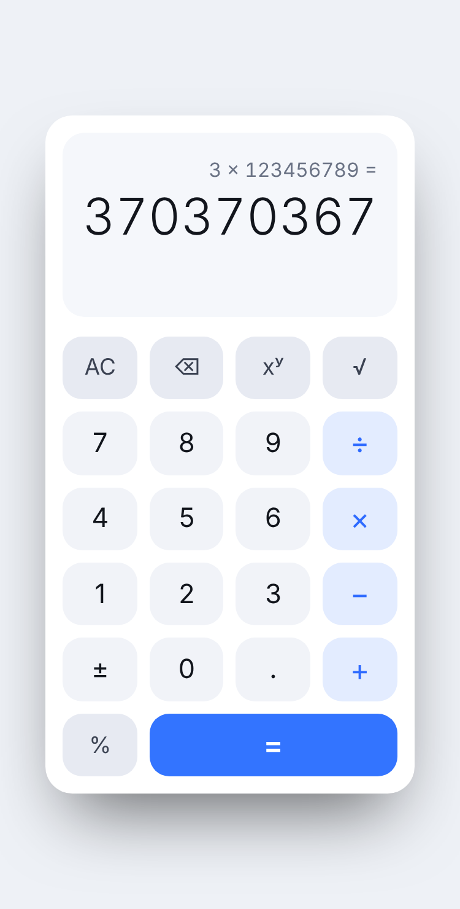

# Sezzle Calculator

A full-stack calculator built as a technical exercise:

- **Backend:** Go REST API using only the standard library (`net/http`).
- **Frontend:** React 19 + TypeScript, built with Vite and styled with CSS Modules.
- **Infrastructure:** Docker images for both services and a `docker-compose.yml` that starts everything with one command.

| Desktop | Mobile |
|---|---|
|  |  |

---

## Table of contents

1. [Features](#features)
2. [Quick start](#quick-start)
3. [Repository structure](#repository-structure)
4. [Architecture and technical decisions](#architecture-and-technical-decisions)
5. [Running locally](#running-locally)
6. [Running with Docker](#running-with-docker)
7. [Testing and coverage](#testing-and-coverage)
8. [API reference](#api-reference)
9. [Possible improvements](#possible-improvements)

---

## Features

- **Basic operations:** addition, subtraction, multiplication and division.
- **Advanced operations:** exponentiation, square root and percentage (`a % of b`).
- **Strict validation on the backend:** division by zero, square root of negative numbers, empty, malformed or non-numeric input, out-of-range numbers, overflow and non-real results. Each one is reported with a semantic HTTP status code and a machine-readable error code.
- **Client-side validation:** the UI never sends empty or incomplete requests.
- **Friendly error messages:** backend error codes are shown in plain language, e.g. *"Cannot divide by zero"*.
- **Keyboard support** in addition to the on-screen keypad.
- **Responsive and accessible UI:** works on mobile and desktop, follows the system light/dark theme, and uses ARIA labels and live regions.
- **Chained operations,** like a physical calculator: `2 + 3 × 4 =` computes left to right and gives `20`.

---

## Quick start

```bash
docker compose up --build
```

- Frontend: <http://localhost:3000>
- Backend: <http://localhost:8080/health>

---

## Repository structure

```
sezzle-calculator/
├── docker-compose.yml
├── README.md
├── docs/                              # screenshots
├── backend/
│   ├── cmd/server/main.go             # entry point: wiring, config, graceful shutdown
│   ├── internal/
│   │   ├── calculator/                # domain: pure math + domain errors (no HTTP)
│   │   ├── handler/                   # HTTP layer: decoding, validation, error mapping
│   │   ├── middleware/                # CORS
│   │   └── model/                     # request/response DTOs (the JSON contract)
│   ├── Dockerfile
│   ├── Makefile
│   └── go.mod
└── frontend/
    ├── src/
    │   ├── components/Calculator/     # Calculator (container), Display, Keypad + CSS Module
    │   ├── hooks/                     # useCalculator (state + API), useKeyboard
    │   ├── services/calculatorApi.ts  # typed HTTP client
    │   ├── state/calculatorReducer.ts # pure state machine
    │   ├── types/calculator.ts        # TypeScript mirror of the Go DTOs
    │   └── utils/format.ts            # number formatting helpers
    ├── Dockerfile
    ├── nginx.conf
    └── vite.config.ts                 # Vite + Vitest configuration
```

---

## Architecture and technical decisions

### Monorepo

Both apps live in one repository so that a change to the API contract and the matching UI change can ship in the same commit and be reviewed together. Each folder is still self-contained, with its own dependencies, tests and Dockerfile, so they can be split into separate repositories later.

### Backend

The backend is split into layers. Dependencies point inward:

```
HTTP request → middleware (CORS) → handler → calculator service
                                      ↑
                                 model (DTOs)
```

| Layer | Responsibility | Knows about HTTP? |
|---|---|---|
| `calculator` | Math rules and domain errors (`ErrDivisionByZero`, `ErrOverflow`, …) | No |
| `handler` | Decode and validate JSON, call the service, map errors to status codes | Yes |
| `model` | The public JSON contract | No |
| `middleware` | Cross-cutting concerns (CORS) | Yes |

**Why the standard library instead of `gin` or `chi`?** Since Go 1.22, `http.ServeMux` supports method-aware patterns such as `"POST /api/v1/calculate"` and replies with `405 Method Not Allowed` for wrong methods. With only two routes, a framework would add a dependency and a new API to learn without removing any code. If the API grew to many route groups and middlewares, `chi` would be the next step, because it is fully compatible with `net/http`.

**Why one `POST /api/v1/calculate` endpoint with an `operation` field?** Every operation has the same request and response shape. With one endpoint, validation and error handling live in one place, the frontend needs a single client function, and adding an operation does not require a new route. The `/v1` prefix allows breaking changes to ship later without breaking existing clients.

**Error handling.**

- The domain returns *sentinel errors*. The handler is the only place that translates them into HTTP status codes, using `errors.Is`. As a result, the math has no HTTP concepts and the HTTP layer has no math.
- Every error uses the same envelope: `{"error":{"code","message"}}`. The `code` is stable and meant for programs, so the frontend can branch on it. The `message` is meant for people.
- Unexpected errors return `500` with a generic message and are logged on the server, so internal details never leak to clients. A test covers this.

**Input validation and edge cases.**

| Case | How it is detected | Response |
|---|---|---|
| Empty body, malformed JSON, unknown fields, trailing data | Strict `json.Decoder` (`DisallowUnknownFields`, `More()`) | `400 INVALID_JSON` |
| Non-numeric operand (`"abc"`, `true`, `"2"`) | `json.UnmarshalTypeError` | `400 INVALID_OPERAND` |
| Number outside the float64 range (`1e400`) | Decoder range error | `400 INVALID_OPERAND` |
| Missing or `null` operand | Operands are `*float64`, so `nil` means "missing", while `0` is a valid value | `400 MISSING_OPERAND` |
| Unknown operation | `ParseOperation` | `400 UNSUPPORTED_OPERATION` |
| Division by zero, including `0 ^ -n` | Explicit check | `400 DIVISION_BY_ZERO` |
| Square root of a negative number | Explicit check | `400 NEGATIVE_SQUARE_ROOT` |
| Result is `±Inf` (overflow) | `math.IsInf` on every result | `400 OVERFLOW` |
| Result is `NaN` (e.g. `(-8)^0.5`) | `math.IsNaN` | `400 UNDEFINED_RESULT` |
| Wrong `Content-Type` | Header check | `415 UNSUPPORTED_MEDIA_TYPE` |
| Body larger than 1 KB | `http.MaxBytesReader` | `400 INVALID_JSON` |

**Floating-point precision.** Results are rounded to 15 significant digits, which is the precision a float64 can guarantee. This hides binary rounding noise, so `0.1 + 0.2` returns `0.3` instead of `0.30000000000000004`.

**Production readiness.** The server sets read and write timeouts (slow-client protection), shuts down gracefully on `SIGTERM`, and is configured through environment variables. The Docker image is distroless and runs as a non-root user.

### Frontend

```
Calculator (container)
├── useCalculator ── calculatorReducer (pure state machine)
│        └──────── calculatorApi (typed fetch client)
├── useKeyboard ── handleKey (pure key → action mapping)
├── Display (presentational)
└── Keypad  (presentational, declarative key layout)
```

- **The API service is isolated** in `services/calculatorApi.ts`. It is the only file that knows about URLs, `fetch` and HTTP status codes. Every failure (backend error, network failure, timeout, unexpected response) is turned into a single `CalculatorApiError` type with a `code` and a `userMessage`, so the UI handles exactly one error type.
- **Strict typing end to end.** `types/calculator.ts` mirrors the Go DTOs. `CalculateRequest` is a discriminated union: TypeScript rejects a `sqrt` request that includes `b`, and a binary request that leaves it out. Responses are checked with runtime type guards, because data from the network should not be trusted blindly. `strict` and `noUncheckedIndexedAccess` are enabled.
- **State lives in a pure reducer.** All calculator behaviour (typing, operator chaining, overwriting a result, errors) is a pure function with no React or I/O, so it is cheap to test and easy to reason about. The `useCalculator` hook only coordinates the reducer and the API.
- **Client-side validation.** `=` with nothing to compute does nothing. `=` right after an operator shows *"Enter a second number first"* instead of sending a request. Input is limited to 15 digits. The keypad is disabled while a request is in flight, which prevents duplicate or out-of-order requests.
- **Why plain `fetch` instead of `axios`?** The app makes a single POST. Native `fetch` plus `AbortController` (for the 8-second timeout) covers it without an extra dependency.
- **Why CSS Modules instead of Tailwind?** The UI is one component tree with a small design system expressed as CSS custom properties. CSS Modules give scoped class names with zero runtime and no extra tooling, and the styles stay readable for reviewers who don't use Tailwind.
- **Accessibility.** Every button has an `aria-label`. The display is an `<output>` with `aria-live`, so screen readers announce results. Errors use `role="alert"`, the active operator uses `aria-pressed`, keyboard focus is visible, and animations are disabled when the user prefers reduced motion.

### Keyboard shortcuts

| Key | Action |
|---|---|
| `0`–`9` | Digits |
| `.` or `,` | Decimal point |
| `+` `-` `*` (or `x`) `/` | Add, subtract, multiply, divide |
| `^` | Power |
| `%` | Percentage (`a % of b`) |
| `r` | Square root |
| `Enter` or `=` | Equals |
| `Backspace` | Delete last digit |
| `Esc`, `Delete` or `c` | Clear |
| `F9` | Toggle sign |

### Docker

- **Backend:** multi-stage build, from `golang:1.24-alpine` to `distroless/static:nonroot`. The result is a small static binary with no shell, running as a non-root user.
- **Frontend:** multi-stage build, from `node:22-alpine` to `nginx:alpine`. nginx serves the static build and **proxies `/api` to the backend**, so in Docker the browser only talks to one origin and CORS is not involved. CORS is still configured on the backend for local development, where Vite (`:5173`) calls the API (`:8080`) directly.

---

## Running locally

### Prerequisites

- Go **1.22+**
- Node.js **20.19+** (or 22.12+) and npm

### 1. Backend

```bash
cd backend
go run ./cmd/server          # or: make run
# → calculator API listening on :8080
```

| Environment variable | Default | Description |
|---|---|---|
| `PORT` | `8080` | HTTP port |
| `CORS_ALLOWED_ORIGINS` | `http://localhost:5173,http://localhost:3000` | Comma-separated list of allowed browser origins |

### 2. Frontend

In a second terminal:

```bash
cd frontend
cp .env.example .env         # VITE_API_URL=http://localhost:8080
npm install
npm run dev
# → http://localhost:5173
```

| Environment variable | Default | Description |
|---|---|---|
| `VITE_API_URL` | `http://localhost:8080` | Base URL of the API. Set it to an empty string to use the same origin. |

Other scripts: `npm run build` (type-check and production build), `npm run preview`, `npm run lint`, `npm run typecheck`.

---

## Running with Docker

```bash
docker compose up --build          # build and start both services
docker compose up -d --build       # same, in the background
docker compose logs -f             # follow logs
docker compose down                # stop and remove containers
```

| Service | URL |
|---|---|
| Frontend (nginx) | <http://localhost:3000> |
| Backend (direct) | <http://localhost:8080> |

---

## Testing and coverage

### Backend (Go)

Tests are table-driven and live next to the code (`*_test.go`):

- `calculator/service_test.go`: every operation, plus edge cases such as overflow, division by zero, negative square roots, NaN results and floating-point noise.
- `handler/handler_test.go`: HTTP behaviour through `httptest`, covering every status code and error code, JSON edge cases, the response shape, routing (`404`, `405`) and hiding of internal errors.
- `middleware/cors_test.go`: allowed and blocked origins, and preflight requests.

```bash
cd backend
go test ./...                                   # run all tests
go test -race -cover ./...                      # with the race detector and coverage per package
go test -coverprofile=coverage.out ./...        # write a coverage profile
go tool cover -func=coverage.out                # coverage per function
go tool cover -html=coverage.out -o coverage.html   # HTML report

# Shortcuts
make test
make cover
make cover-html
```

Current coverage: `calculator` 97%, `handler` 97%, `middleware` 100%. `cmd/server` is wiring only and is not unit tested.

### Frontend (Vitest + React Testing Library)

- `services/calculatorApi.test.ts`: request format, mapping of every error code, network errors, timeouts and malformed responses (`fetch` is mocked).
- `state/calculatorReducer.test.ts`: the pure state machine.
- `utils/format.test.ts`: number formatting.
- `components/Calculator/Calculator.test.tsx`: rendering, clicks, keyboard input, client-side validation, loading state and API error messages. The API module is mocked with `vi.mock`.

```bash
cd frontend
npm test                  # run once
npm run test:watch        # watch mode
npm run coverage          # text summary + HTML report in frontend/coverage/index.html
```

Current coverage: about 93% of statements and 91% of branches.

---

## API reference

### `GET /health`

```bash
curl http://localhost:8080/health
```

```json
{ "status": "ok" }
```

### `POST /api/v1/calculate`

**Request** (`Content-Type: application/json`):

| Field | Type | Required |
|---|---|---|
| `operation` | `"add"`, `"subtract"`, `"multiply"`, `"divide"`, `"power"`, `"sqrt"` or `"percentage"` | Yes |
| `a` | number | Yes |
| `b` | number | Yes, except for `sqrt` (ignored there) |

`percentage` computes **`a` percent of `b`**: `percentage(15, 200) = 30`.

**Success: `200 OK`**

```bash
curl -s -X POST http://localhost:8080/api/v1/calculate \
  -H "Content-Type: application/json" \
  -d '{"operation":"divide","a":10,"b":4}'
```

```json
{ "operation": "divide", "a": 10, "b": 4, "result": 2.5 }
```

More examples:

```bash
# Power: 2^10 = 1024
curl -s -X POST http://localhost:8080/api/v1/calculate \
  -H "Content-Type: application/json" -d '{"operation":"power","a":2,"b":10}'

# Square root: b is not needed
curl -s -X POST http://localhost:8080/api/v1/calculate \
  -H "Content-Type: application/json" -d '{"operation":"sqrt","a":81}'

# Percentage: 15% of 200 = 30
curl -s -X POST http://localhost:8080/api/v1/calculate \
  -H "Content-Type: application/json" -d '{"operation":"percentage","a":15,"b":200}'
```

**Error: `400 Bad Request`**

```bash
curl -s -i -X POST http://localhost:8080/api/v1/calculate \
  -H "Content-Type: application/json" \
  -d '{"operation":"divide","a":10,"b":0}'
```

```http
HTTP/1.1 400 Bad Request
Content-Type: application/json

{"error":{"code":"DIVISION_BY_ZERO","message":"division by zero is not allowed"}}
```

```bash
# Non-numeric operand
curl -s -X POST http://localhost:8080/api/v1/calculate \
  -H "Content-Type: application/json" -d '{"operation":"add","a":"abc","b":1}'
# {"error":{"code":"INVALID_OPERAND","message":"operand \"a\" must be a finite number within the float64 range"}}

# Square root of a negative number
curl -s -X POST http://localhost:8080/api/v1/calculate \
  -H "Content-Type: application/json" -d '{"operation":"sqrt","a":-9}'
# {"error":{"code":"NEGATIVE_SQUARE_ROOT","message":"cannot calculate the square root of a negative number"}}

# Overflow
curl -s -X POST http://localhost:8080/api/v1/calculate \
  -H "Content-Type: application/json" -d '{"operation":"power","a":10,"b":400}'
# {"error":{"code":"OVERFLOW","message":"result is too large to be represented (overflow)"}}
```

**Status codes**

| Status | When |
|---|---|
| `200 OK` | Successful calculation |
| `400 Bad Request` | Invalid input or a math domain error (see the error codes below) |
| `404 Not Found` | Unknown route |
| `405 Method Not Allowed` | Wrong HTTP method, e.g. `GET /api/v1/calculate` |
| `415 Unsupported Media Type` | `Content-Type` is not `application/json` |
| `500 Internal Server Error` | Unexpected error (details are logged, never returned) |

**Error codes:** `INVALID_JSON`, `INVALID_OPERAND`, `MISSING_OPERAND`, `UNSUPPORTED_OPERATION`, `DIVISION_BY_ZERO`, `NEGATIVE_SQUARE_ROOT`, `OVERFLOW`, `UNDEFINED_RESULT`, `UNSUPPORTED_MEDIA_TYPE`, `INTERNAL_ERROR`.

---

## Possible improvements

Left out on purpose to keep the scope focused:

- **Arbitrary precision** (e.g. `math/big` or a decimal library) for exact financial math, instead of float64.
- **An OpenAPI specification**, with frontend types generated from it, so the contract cannot drift between the two apps.
- **Structured logging** (`log/slog`) with request IDs, plus Prometheus metrics.
- **End-to-end tests** with Playwright against the Docker Compose stack, and a CI pipeline (GitHub Actions) running lint, tests and coverage for both apps.
- **Rate limiting** on the API.
- **Calculation history** stored in the browser.


---

## AI assistance

This project was developed with the help of an AI assistant (Claude, by Anthropic),
used as a pair-programming mentor. I defined the requirements, reviewed the code,
ran the tests locally and with Docker, and I am able to explain and modify every part
of it.

Prompts used (summarized):

1. **Backend:** "Act as a Senior Software Engineer mentoring a Junior developer. Build the
   backend of a full-stack calculator in Go: layered architecture (handlers, service,
   models), standard `net/http`, basic and advanced operations (power, square root,
   percentage), strict validation of edge cases (division by zero, negative square root,
   empty/non-numeric input, overflow), semantic HTTP status codes with JSON errors, CORS
   for local development, and table-driven unit tests with coverage."
2. **Frontend and docs:** "Build the frontend with React + TypeScript and Vite: responsive
   calculator UI, a dedicated typed API service, client-side validation, friendly error
   messages, keyboard support, and Vitest + React Testing Library tests with a mocked
   API. Add Dockerfiles and a docker-compose file, and write a professional README in
   English."
3. Follow-up questions about running the project locally, Docker, and publishing it to GitHub.
